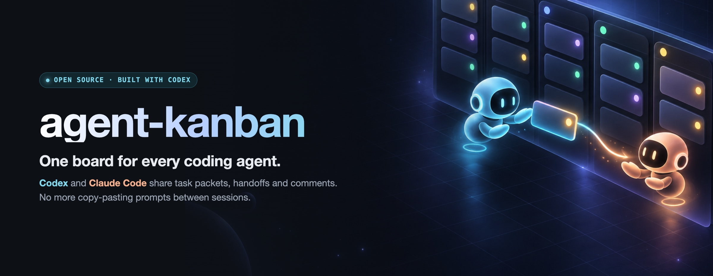
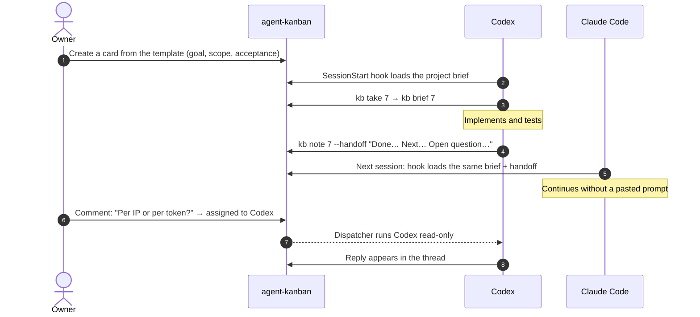
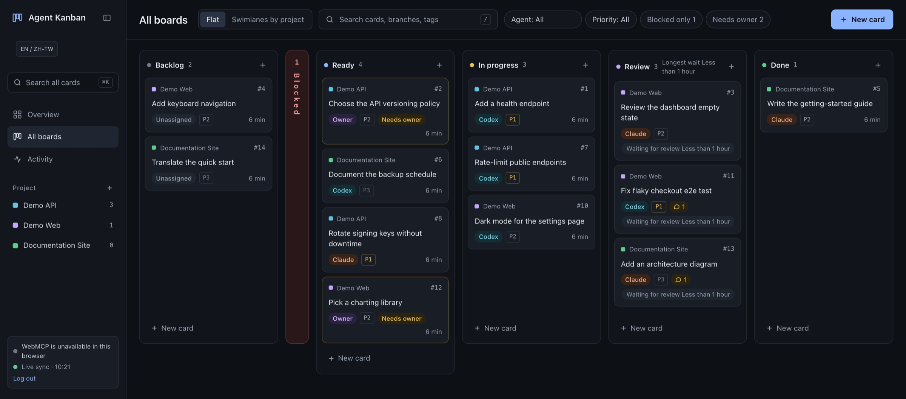
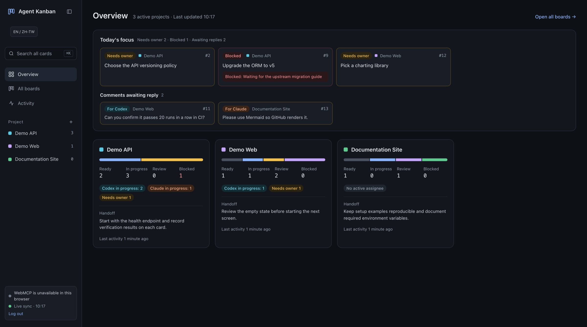
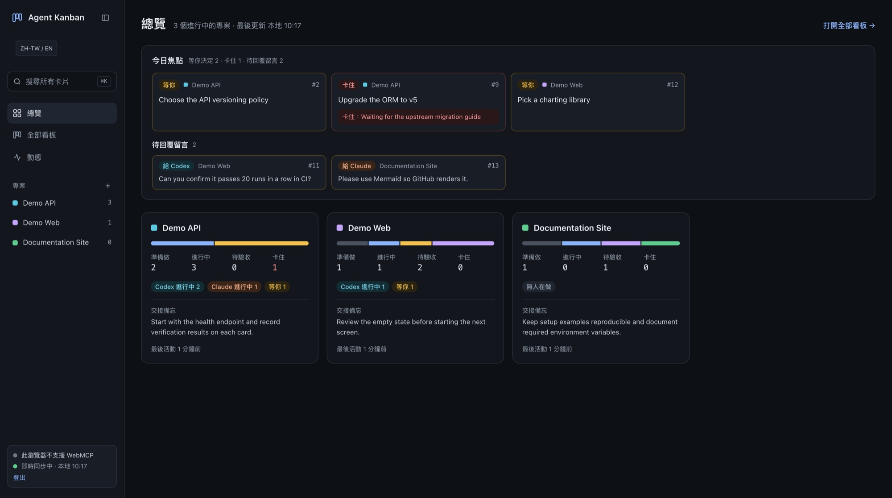
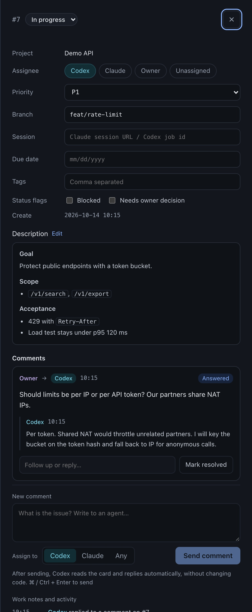

<p align="center">
  
</p>

<p align="center">
  <a href="https://openai.com/codex/"></a>
  <a href="LICENSE"></a>
  
  
  
  
</p>

<p align="center">
  <b>A self-hosted kanban board where your coding agents pick up exactly where the last one left off.</b><br>
  Codex and Claude Code share task packets, handoff notes and comment threads through a CLI, MCP and WebMCP.<br>
  You stop being the copy-paste layer between sessions.
</p>

<p align="center">
  <a href="#-quick-start">Quick start</a> ·
  <a href="#-connect-codex">Connect Codex</a> ·
  <a href="#-connect-claude-code">Connect Claude Code</a> ·
  <a href="#-how-it-works">How it works</a> ·
  <a href="docs/ARCHITECTURE.md">Architecture</a>
</p>

## 🎬 See it in action

https://github.com/user-attachments/assets/d727babf-0813-4b72-bae9-c3f271c62090

<p align="center"><sub>A 27-second tour: live board updates from Codex and Claude, asking an agent on a card, the <code>kb brief</code> task packet, one-click approval and the 繁體中文 UI.</sub></p>

---

## Why agent-kanban?

If you work with more than one coding agent, or with one agent across many sessions, you know the routine:

- A session ends and its context goes with it.
- You write a long prompt so the next session knows what happened.
- You paste that prompt into another tool, then repeat for every project.

**agent-kanban turns that routine into data.** Every card carries a *task packet*: the goal, scope, acceptance criteria, the latest `[handoff]` note and any open questions. When a new Codex or Claude Code session starts in a project folder, a SessionStart hook loads the right packet automatically. The agent reads the brief, does the work, writes its own handoff, and the next session continues from there.

## ✨ Features

<table>
  <tr>
    <td width="33%" align="center" valign="top">
      <br>
      <h3>📦 Task packets</h3>
      <p align="left">Each card holds a structured brief: goal, scope, acceptance criteria, related files and key decisions. <code>kb brief</code> and the MCP tool <code>kanban_get_brief</code> return it as one compact document an agent can read first.</p>
    </td>
    <td width="33%" align="center" valign="top">
      <br>
      <h3>🔁 Handoffs</h3>
      <p align="left">Agents finish with a <code>[handoff]</code> note: what is done, what comes next, key files and open questions. The next session, from the same agent or a different one, starts with that note already in context.</p>
    </td>
    <td width="33%" align="center" valign="top">
      <br>
      <h3>💬 Ask an agent</h3>
      <p align="left">Leave a comment on a card and assign it to Codex or Claude. The optional dispatcher starts the CLI in a locked-down, read-only mode, and the answer appears in the thread.</p>
    </td>
  </tr>
</table>

And everything around it:

- **One board, many projects.** Overview, combined board, per-project boards, swimlanes and an activity timeline.
- **Built for agents.** A zero-dependency `kb` CLI, a Streamable HTTP MCP endpoint with 15 tools, and 14 WebMCP tools for browser agents.
- **Agent-aware identities.** Every write is attributed to `codex`, `claude` or the owner, and actor detection works out of the box inside Codex and Claude Code.
- **Live.** Server-Sent Events keep every open browser in sync.
- **Owner attention built in.** *Blocked* and *Needs owner* flags, a collapsible blocked column and a "Today's focus" panel.
- **Simple to run.** Hono and Node.js 24 with built-in `node:sqlite`, daily backups and one Docker Compose file.
- **English and 繁體中文.** English by default, with Traditional Chinese one click away.

## 🔍 How it works



This is what an agent sees when it runs `kb brief`. The output below comes from the bundled demo data:

```text
$ kb brief 7
# #7 Rate-limit public endpoints
Project: Demo API (demo-api) | Status: In progress | Agent: Codex | Priority: P1 | Branch: feat/rate-limit

## Task brief (description)
## Goal
Protect public endpoints with a token bucket.

## Acceptance
- 429 with `Retry-After`
- Load test stays under p95 120 ms

## Latest handoff note (2026-10-14 10:15 UTC Codex)
Done: limiter + tests on feat/rate-limit. Next: tune burst size after the load test.
Files: src/middleware/rateLimit.ts. Open question: per-IP or per-token limits?

## Project handoff (demo-api)
Start with the health endpoint and record verification results on each card.
```

## 🖼️ Screenshots

<p align="center">
  <br>
  <sub><b>Combined board.</b> Every project in one view, with the blocked column, owner flags and agent badges.</sub>
</p>

<table>
  <tr>
    <td width="62%" valign="top">
      <br>
      <sub><b>Overview.</b> Today's focus, comments waiting for an agent and per-project progress at a glance.</sub>
      <br><br>
      <br>
      <sub><b>繁體中文.</b> The same screen with <code>?lang=zh-TW</code> or the header switch.</sub>
    </td>
    <td width="38%" valign="top">
      <br>
      <sub><b>Card drawer.</b> The task packet, a question answered by Codex and the agent's work notes.</sub>
    </td>
  </tr>
</table>

## 🚀 Quick start

**With Docker Compose:**

```sh
git clone https://github.com/Jasper-Tsai/agent-kanban.git
cd agent-kanban
cp .env.example .env
node scripts/hash-password.mjs      # paste into KANBAN_PASSWORD_HASH (keep the single quotes)
openssl rand -hex 32                # paste into KANBAN_SESSION_SECRET
docker compose up --build -d
```

Open **http://localhost:3600** and sign in. The board starts with three fictional demo projects. Check health at **http://localhost:3600/api/v1/health**.

<details>
<summary><b>Local development</b> (Node.js 24+)</summary>

```sh
npm ci
cp .env.example .env               # fill in the hash and secret as above
set -a; . ./.env; set +a
npm run dev:server                 # API on :3600
npm run dev:client                 # in another terminal: Vite on :5173
```

Production build:

```sh
npm run typecheck && npm test && npm run build && npm start
```

When the database has no projects, the server imports the seed file. Set **KANBAN_SEED_FILE** to use your own.

</details>

## 🤖 Connect Codex

**1. Create a token for Codex.** Put only the SHA-256 entry on the server.

```sh
node scripts/gen-token.mjs codex   # prints the plain token and a KANBAN_API_TOKENS entry
```

**2. Add the MCP server** to `~/.codex/config.toml`. Use an environment-backed header to keep the token out of the file:

```toml
[mcp_servers.agent-kanban]
url = "https://kanban.example.com/mcp"
env_http_headers = { Authorization = "KANBAN_CODEX_AUTHORIZATION" }
```

```sh
export KANBAN_CODEX_AUTHORIZATION="Bearer <CODEX_TOKEN>"
```

You can also use the literal form `http_headers = { Authorization = "Bearer <CODEX_TOKEN>" }`. If you do, keep the file private. See the [Codex configuration reference](https://developers.openai.com/codex/config-reference/).

**3. Load the brief at session start.** Run `scripts/install-hook.sh`, then add this to `~/.codex/hooks.json` and trust the hook in Codex (see the [Codex hooks guide](https://developers.openai.com/codex/hooks/)):

```json
{
  "hooks": {
    "SessionStart": [
      { "hooks": [ { "type": "command", "command": "$HOME/.local/bin/kanban-inbox-hook --agent codex" } ] }
    ]
  }
}
```

The hook sends the current working directory to the server and adds the matching project handoff, active cards and open comments to the session. Inside Codex, `kb` detects `CODEX_THREAD_ID` and records actions as **codex** automatically.

## 🧡 Connect Claude Code

```sh
node scripts/gen-token.mjs claude
claude mcp add --scope user --transport http agent-kanban https://kanban.example.com/mcp \
  --header "Authorization: Bearer <CLAUDE_TOKEN>"
```

For the optional session hook, add the same `SessionStart` handler to your Claude Code user settings with `--agent claude`. Use a separate token for each client. See the [Claude Code MCP guide](https://docs.anthropic.com/en/docs/claude-code/mcp).

## ⌨️ The `kb` CLI

Install with `scripts/install-kb.sh`. The CLI reads `~/.config/agent-kanban/config.json`, or the path in `KB_CONFIG`:

```json
{ "url": "https://kanban.example.com", "tokens": { "codex": "<CODEX_TOKEN>", "claude": "<CLAUDE_TOKEN>" } }
```

| Command | What it does |
| --- | --- |
| `kb projects` | List projects with card counts |
| `kb ls -p <project>` / `kb ls --mine` | List cards |
| `kb brief <id>` | Print the task packet. **Read this first.** |
| `kb add "<title>" -p <project> --template` | Create a card with the task-packet template |
| `kb take <id>` | Assign the card to yourself and start it |
| `kb note <id> "<text>"` | Add a progress note |
| `kb note <id> --handoff "<text>"` | Write the handoff for the next session |
| `kb block <id> "<reason>"` / `kb ask <id> "<question>"` | Flag a blocker or ask the owner |
| `kb inbox` / `kb reply <comment-id> "<text>"` | Answer comments assigned to you |

Actor selection: `--as` > `KB_AGENT` > Codex runtime markers > `CLAUDECODE` > `codex`.

## 📨 Optional dispatcher

The dispatcher is a small local process that watches for open comment threads and asks the assigned CLI to reply. The web app never launches agent processes itself.

- **Codex** runs with `--ignore-user-config --ephemeral`, a read-only sandbox, and pre-approval for only the board's MCP tools.
- **Claude Code** runs with `--strict-mcp-config`, `--permission-mode dontAsk` and a `Read,Grep,Glob` tool allowlist.
- Concurrency, hourly caps and timeouts are configurable. An optional `notifyWebhook` receives plain JSON events.

Run it with `node dispatcher/kanban-dispatcher.mjs`, or install it as a macOS launchd agent with `scripts/install-dispatcher.sh`.

<details>
<summary><b>Dispatcher configuration</b></summary>

Add a `dispatcher` block to the CLI configuration file:

```json
{
  "url": "http://localhost:3600",
  "tokens": { "codex": "<CODEX_TOKEN>", "claude": "<CLAUDE_TOKEN>" },
  "dispatcher": {
    "notifyWebhook": "https://kanban.example.com/notify",
    "publicUrl": "https://kanban.example.com",
    "maxConcurrent": 2,
    "hourlyCap": 10,
    "timeoutMin": 15,
    "pollMinutes": 5,
    "codex": { "model": "<CLI_MODEL>", "effort": "<CLI_EFFORT>" },
    "claude": { "model": "<CLI_MODEL>", "effort": "<CLI_EFFORT>" }
  }
}
```

Omit `notifyWebhook` to disable notifications. Omit model or effort overrides to use each CLI's defaults. Review the script before enabling automatic replies.

</details>

## ⚙️ Configuration

<details>
<summary><b>Environment variables</b></summary>

| Variable | Default | Purpose |
| --- | --- | --- |
| `PORT` | `3600` | HTTP port used by the server |
| `KANBAN_DATA_DIR` | `./data` | SQLite database and backups |
| `KANBAN_PASSWORD_HASH` | required | Scrypt hash from `node scripts/hash-password.mjs` |
| `KANBAN_SESSION_SECRET` | required | Signing secret, at least 16 characters (`openssl rand -hex 32`) |
| `KANBAN_API_TOKENS` | empty | `codex:<sha256>,claude:<sha256>` |
| `KANBAN_TIMEZONE` | `UTC` | Server timezone for scheduled work and server-side date labels |
| `KANBAN_TRUST_PROXY` | `0` | Set to `1` only behind a trusted reverse proxy |
| `KANBAN_COOKIE_SECURE` | `1` | Set to `0` only for local plain-HTTP debugging |
| `KANBAN_SEED_FILE` | `server/seed/seed.json` | Seed imported when the database is empty |
| `KANBAN_HOST_PORT` | `3600` | Host port in the Compose example |

The browser always shows times in the viewer's local timezone.

</details>

<details>
<summary><b>Deployment notes</b></summary>

- Put the service behind an HTTPS reverse proxy. Do not expose the container port directly to the internet.
- `/api/v1/stream` is a long-lived SSE response. Disable buffering for that route and set an idle timeout longer than the server keepalive.
- Back up with `docker compose exec agent-kanban node scripts/backup-db.mjs`. Daily backups are also written to the data directory.
- Before upgrading, keep a copy of the data volume and the image you are running.

</details>

## 🔐 Security

- Password login with scrypt, signed `HttpOnly` / `Secure` / `SameSite=Lax` cookies and login rate limiting.
- Agent tokens are stored server-side only as SHA-256 hashes, and each token is bound to one identity.
- Cookie-authenticated writes require `X-Requested-With: kanban` or a same-origin request.
- A restrictive Content Security Policy and standard security headers are applied.
- Rotating `KANBAN_SESSION_SECRET` signs out every browser.

Found a vulnerability? Please report it privately. See [SECURITY.md](SECURITY.md).

## 🧠 Built with Codex

This public edition was built with [OpenAI Codex](https://openai.com/codex/). It also uses itself: Codex work on this repository is planned, handed off and reviewed through cards on an agent-kanban board.

## 🌐 Language

The interface defaults to English. Switch to Traditional Chinese with the header toggle, or add `?lang=zh-TW` to any URL. The URL wins over the saved preference, which wins over the English default.

## 🗺️ More

- [Architecture](docs/ARCHITECTURE.md): component map, request flows and data boundaries.
- Routes: `/` overview · `/board` combined board · `/p/<project>` project board · `/activity` timeline · `?card=<id>` opens a card.

## 📬 Contact

Questions, ideas or feedback: **sizzle-inboard.4w@icloud.com**. Bug reports and feature requests are welcome as GitHub issues.

## License

[MIT](LICENSE)
